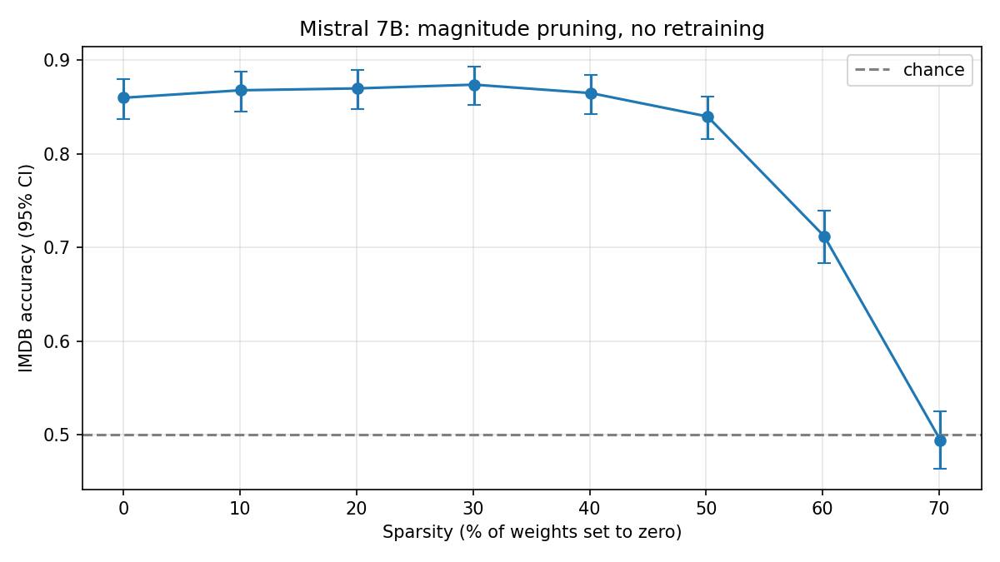
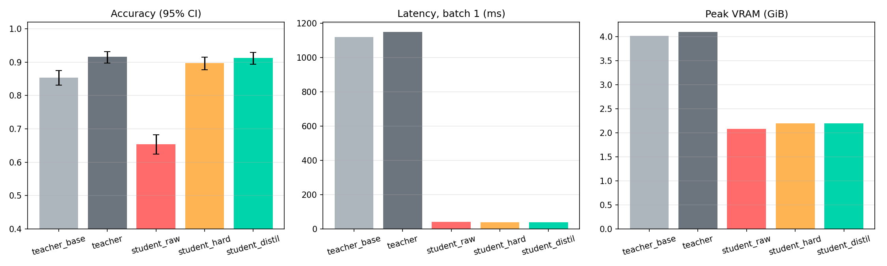
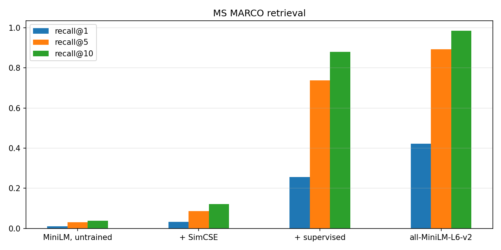

# mistral-optimisation

The goal of the project is to leverage the Mistral 7B model while optimizing it to minimize resource consumption.

Each step is measured on the same task: binary sentiment classification on IMDB, with `Mistral-7B-Instruct-v0.3` as the reference model.

## Status

| Step | Notebook | Model on the Hub | State |
| ------ | ---------- | ------------------ | ------- |
| v0.1 Baseline, v0.2 Quantization | [quantization.py](kaggle/v0.2-quantization/quantization.py) | | Done for fp16, int8 and NF4 |
| v0.3 QLoRA | [v0.5-distillation](notebooks/v0.5-distillation.ipynb) (teacher, §4) | [mistral-nf4-sentiment](https://huggingface.co/Falcot922/mistral-nf4-sentiment) | Done |
| v0.4 Pruning | [pruning.py](kaggle/v0.4-pruning/pruning.py) | [mistral-pruned-iterative-sentiment](https://huggingface.co/Falcot922/mistral-pruned-iterative-sentiment), [mistral-pruned-20-adapter](https://huggingface.co/Falcot922/mistral-pruned-20-adapter) | Done |
| v0.5 Distillation | [v0.5-distillation](notebooks/v0.5-distillation.ipynb) | not pushed yet | Done |
| v0.55 Embeddings and RAG | [retrieval.py](kaggle/v0.55-retrieval/retrieval.py) | not pushed yet | Done |
| v1.0 Dashboard | | | Done |

Results are tracked with pandas (CSV files) and matplotlib.

## Results: quantization (v0.1, v0.2)

Mistral-7B-Instruct-v0.3 loaded in three precisions on a Kaggle T4. Quality is zero-shot sentiment accuracy on 500 balanced IMDB test reviews. Raw file: [results/v0.2/quantization.csv](results/v0.2/quantization.csv).

| Precision | Accuracy (95% CI) | Weights | Peak VRAM | Generation speed |
| ----------- | ------------------- | --------- | ----------- | ------------------ |
| fp16 | 86.0% (82.7 to 88.8) | 13.5 GiB | 13.6 GiB | 4.6 tokens/s |
| int8 (bitsandbytes) | 86.6% (83.3 to 89.3) | 7.0 GiB | 7.5 GiB | 4.0 tokens/s |
| NF4 (bitsandbytes) | 85.8% (82.5 to 88.6) | 3.8 GiB | 4.0 GiB | 14.8 tokens/s |

Quantization to 4 bits divides memory by 3.4 with no measurable loss of accuracy on this task.
Note: the fp16 speed is not a representative indicator. The model takes 13.6 of the T4's 15 GiB, and running that close to the limit probably slowed it down.

## Results: QLoRA (v0.3)

The QLoRA adapter was trained in the [distillation notebook](notebooks/v0.5-distillation.ipynb) (§4), where it plays the role of the teacher, so its results are stored with v0.5. Mistral-7B-Instruct-v0.3 in NF4, LoRA rank 8 on the seven projection matrices of every layer (21 million trainable parameters, 0.29% of the model), 800 shuffled IMDB reviews, 100 steps.

| Model | Accuracy (95% CI) |
| ------- | ------------------- |
| Mistral NF4, no adapter | 85.4% (83.1 to 87.5) |
| Mistral NF4 + QLoRA adapter | 91.6% (89.7 to 93.2) |

Same 1,000 IMDB test reviews as the distillation benchmark. On the 116 reviews where the two models disagree, the adapter is right 89 times (paired test, p < 0.001). Raw file: `teacher_base` and `teacher` rows of [results/v0.5/benchmark.csv](results/v0.5/benchmark.csv).

## Results: pruning (v0.4)

Magnitude pruning of the 224 linear layers of Mistral-7B-Instruct-v0.3 (fp16), with no retraining. Zero-shot sentiment accuracy on the same 1,000 IMDB test reviews as the distillation benchmark. Raw files are in [results/v0.4](results/v0.4).

| Weights set to zero | Accuracy (95% CI) |
| --------------------- | ------------------- |
| 0% | 86.0% (83.7 to 88.0) |
| 10% | 86.8% (84.6 to 88.8) |
| 20% | 87.0% (84.8 to 88.9) |
| 30% | 87.4% (85.2 to 89.3) |
| 40% | 86.5% (84.2 to 88.5) |
| 50% | 84.0% (81.6 to 86.1) |
| 60% | 71.2% (68.3 to 73.9) |
| 70% | 49.4% (46.3 to 52.5) |

The model still performs well with 40% of the weights removed, and starts to collapse severely beyond 70%.
In this project I used unstructured pruning, so there is no memory or speed improvement to observe here
(the zeroed weights are still stored and computed in dense tensors).
However, I took some time to understand structured pruning, especially how it applies to the
Query/Key/Value structure of attention layers, which is very specific.



## Results: distillation (v0.5)

Teacher: Mistral-7B-Instruct-v0.3 in NF4 with a QLoRA sentiment adapter. Student: TinyLlama 1.1B with LoRA.
Measured on 1,000 unseen IMDB test reviews (balanced), Kaggle T4, batch size 1. Raw files are in [results/v0.5](results/v0.5).

| Model | Accuracy (95% CI) | Agreement with teacher | Latency | Peak VRAM |
| ------- | ------------------- | ------------------------ | --------- | ----------- |
| Mistral without adapter | 85.4% (83.1 to 87.5) | 88.4% | 1,120 ms | 4.02 GiB |
| Teacher (with QLoRA adapter) | 91.6% (89.7 to 93.2) | | 1,150 ms | 4.10 GiB |
| Student, untrained | 65.4% (62.4 to 68.3) | 66.2% | 41 ms | 2.08 GiB |
| Student, hard labels only | 89.7% (87.7 to 91.4) | 90.3% | 40 ms | 2.20 GiB |
| Student, distilled | 91.3% (89.4 to 92.9) | 92.9% | 40 ms | 2.20 GiB |

The QLoRA adapter lifts the teacher from 85.4% to 91.6% (paired test, p < 0.001).
The distilled student is statistically indistinguishable from the teacher (0.3 points, p = 0.81), 29 times faster, and uses 1.9 times less VRAM.
Against the hard-label student, distillation gains 1.6 points of accuracy (p = 0.033). An earlier run of the same code gave 1.1 points (p = 0.14), so the gain is small and at the edge of what 1,000 examples can show. Agreement with the teacher improves clearly in both runs (p = 0.0003 and p = 0.008).
The speed ratio is inflated: the teacher runs in bitsandbytes 4-bit, which is slow at inference, the student in fp16.



## Results: contrastive embeddings and retrieval (v0.55)

Task: find the passage that answers an MS MARCO query among 9,984 passages.
Starting point: a MiniLM encoder never trained to compare sentences, fine-tuned with a hand-written InfoNCE loop on 20,000 examples (312 steps, a few minutes on a T4). Raw files are in [results/v0.55](results/v0.55).

| Model | Recall@1 | Recall@5 | Recall@10 |
| ------- | ---------- | ---------- | ----------- |
| MiniLM, untrained | 1.0% | 3.2% | 3.9% |
| + SimCSE (unsupervised) | 3.3% | 8.6% | 12.1% |
| + supervised (query, passage) pairs | 25.6% | 73.7% | 87.9% |
| Reference: all-MiniLM-L6-v2 (1 billion pairs) | 42.2% | 89.2% | 98.5% |

The supervised model is then used as the retriever for Mistral 7B; [rag_examples.json](results/v0.55/rag_examples.json) shows five answers with and without retrieved context.



### RAG on the project's own documents

[rag_docs.py](kaggle/v0.55-rag-docs/rag_docs.py) indexes this README and two private documents used to document the project, split into 97 passages, and asks 16 questions in French, each tied to the passage that answers it. It works in two stages: a retriever finds the 3 passages closest to the question, then Mistral answers from them.

Two retrievers are compared on the first stage:

| Retriever | Origin | Recall@1 | Recall@3 |
|-----------|--------|----------|----------|
| Our supervised MiniLM | Trained above, on English MS MARCO pairs | 0% | 0% |
| multilingual-e5-small | Off-the-shelf multilingual model from the Hub, not fine-tuned | 43.8% | 87.5% |

Recall@3 is the share of questions whose source passage is among the 3 passages given to Mistral.

- Our model scores 73.7% Recall@5 on English MS MARCO but finds none of the right passages here: it has only seen English, and its tokenizer splits French words into meaningless pieces. A retrieval score only holds on data that looks like the training data.
- multilingual-e5-small is therefore the retriever that feeds Mistral. With it, 12 of the 16 answers are correct on manual review. Without context, none contains the project-specific answer.
- 16 questions are enough to show the gap between the two retrievers, not to measure either one precisely.

The answers are in [rag_docs_examples.json](results/v0.55/rag_docs_examples.json); DOCUMENTATION.md (entry 9) analyses the four wrong ones.

## Running the notebooks

The notebooks target a Kaggle T4 (16 GB VRAM, 20 GB disk) and write to `/kaggle/working`.

The distillation notebook is run from the command line with the [Kaggle CLI](https://github.com/Kaggle/kaggle-api), using `notebooks/kernel-metadata.json`:

```bash
kaggle kernels push -p notebooks                                      # start a run
kaggle kernels status pamperslegame/mistral-v05-distillation          # queued, running, complete or error
kaggle kernels output pamperslegame/mistral-v05-distillation -p outputs   # logs, benchmark.csv, adapters
```

The retrieval script runs the same way with `-p kaggle/v0.55-retrieval`.

Set `MINI = True` in the configuration to check the whole pipeline in a few minutes before a full run.
